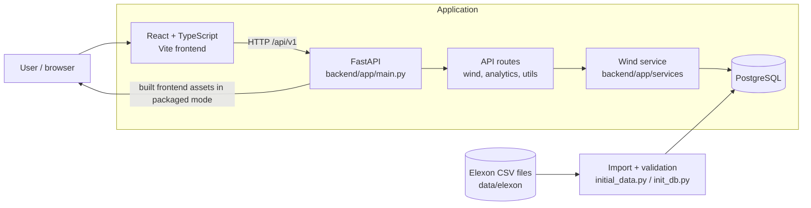
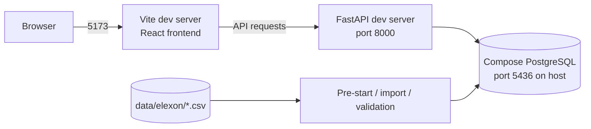
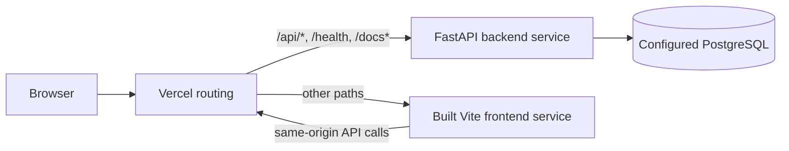

# Renewable Forecast — Architecture

## System at a glance

The application combines a React/TypeScript dashboard with a FastAPI API and PostgreSQL persistence. Historical Elexon wind data is stored as CSV input in the repository and imported/validated into the database during initialization. The frontend consumes the API; API routes delegate wind and analytics work to service code.

## Runtime and deployment

### Local development

`bun run dev` invokes `scripts/dev.sh`. It starts the PostgreSQL Compose service, applies backend pre-start database setup, and launches FastAPI and Vite as separate development servers. The browser uses Vite at `http://localhost:5173`; FastAPI is available at `http://localhost:8000` and its interactive docs at `/docs`.

### Vercel

`vercel.json` defines separate frontend and backend services. Requests under `/api/*`, `/health`, and `/docs*` are routed to the backend; the remaining paths go to the Vite-built frontend. The backend's database connection is supplied through deployment environment configuration.

## Request and data flow

1. Frontend pages and components call the generated API client under `frontend/src/client/`.
2. FastAPI mounts route groups from `backend/app/api/main.py`; analytics routes are also mounted by `backend/app/main.py`.
3. Routes validate query parameters and response shapes, then delegate calculations and data access to `backend/app/services/wind_service.py`.
4. The service reads persisted records through the database session and returns results for API response models in `backend/app/models.py`.
5. The initialization path applies migrations, imports normalized CSV records, and verifies expected record counts, duplicates, and decision coverage. See `backend/app/init_db.py`, `backend/app/initial_data.py`, and `backend/app/wind_csv.py`.

The analytics API includes overview, forecast-versus-actual comparisons, actual generation, accuracy metrics, forecast revisions, and CSV export endpoints. The January 2026 reporting assumptions and validation expectations are configured in `backend/app/core/config.py` and used by the service/import code.

## Codebase map

| Location | Responsibility |
| --- | --- |
| `frontend/src/` | Frontend entry point, pages/routes, components, hooks, utilities, and generated API client. |
| `frontend/src/client/` | Generated client used to call the backend contract. |
| `backend/app/main.py` | FastAPI application setup, middleware, API mounting, and packaged frontend serving. |
| `backend/app/api/` | HTTP routes and request dependencies. |
| `backend/app/services/` | Domain calculations and data access coordination. |
| `backend/app/models.py` | Persistence and API data models. |
| `backend/app/alembic/` | Database schema migrations. |
| `backend/app/core/` | Settings and shared infrastructure such as database configuration. |
| `backend/app/initial_data.py`, `backend/app/wind_csv.py`, `backend/app/init_db.py` | CSV preparation/loading, database setup, and data validation. |
| `data/elexon/` | Historical wind actual and forecast source CSV files. |
| `scripts/` | Development orchestration, import helpers, client generation, and script tests. |
| `compose*.yml` | Local and deployment container topology/configuration. |
| `vercel.json` | Vercel service and request routing configuration. |

## Design boundaries and development practices

- **Frontend/backend contract:** FastAPI's OpenAPI schema informs the generated frontend client. When API response or request schemas change, regenerate the client with `bash scripts/generate-client.sh` and review the generated diff.
- **Persistence:** schema changes belong in Alembic migrations; keep migrations and model changes aligned. Database connection settings come from environment-backed configuration.
- **Data integrity:** imports are designed to be repeatable and initialization validates record totals, duplicates, and decision coverage. When changing imports or calculations, check units, UTC timestamps, missing records, and matching forecast/actual periods.
- **Configuration:** `backend/app/core/config.py` centralizes settings. Use environment variables for deployment-specific values and do not commit secrets.
- **Testing:** frontend checks are available through `bun run lint` and `bun run test`. Backend tests are under `backend/tests/` and run with `cd backend && uv run bash scripts/test.sh`; script-level import tests are under `scripts/tests/`.
- **Operational setup:** Docker Compose supplies the local PostgreSQL service and optional supporting services. `scripts/dev.sh` is the normal combined local entry point.

## Useful entry points

- Local startup: [`README.md`](README.md#start-locally)
- Backend guide: [`backend/README.md`](backend/README.md)
- Frontend guide: [`frontend/README.md`](frontend/README.md)
- Vercel routing: [`vercel.json`](vercel.json)
